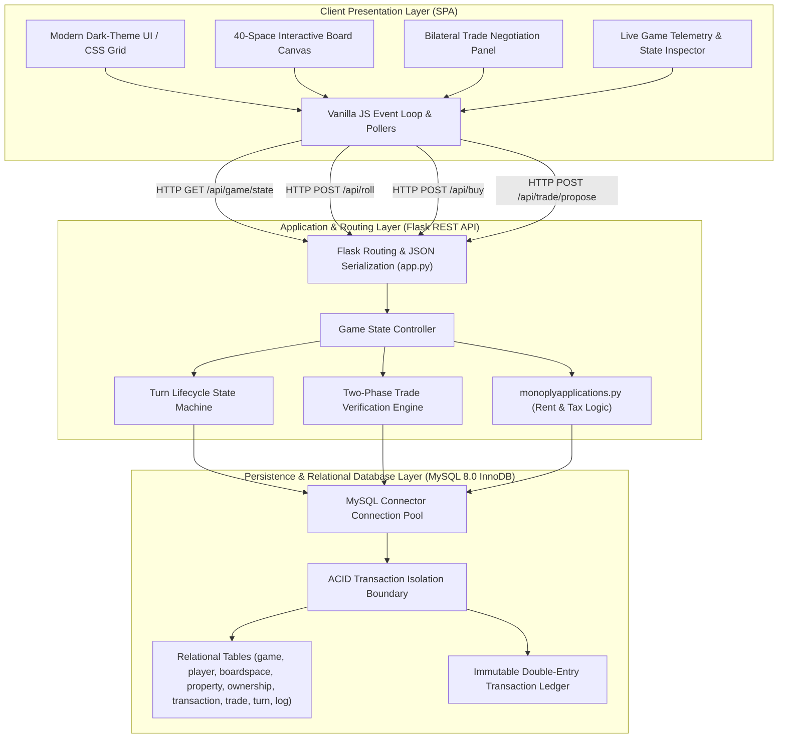
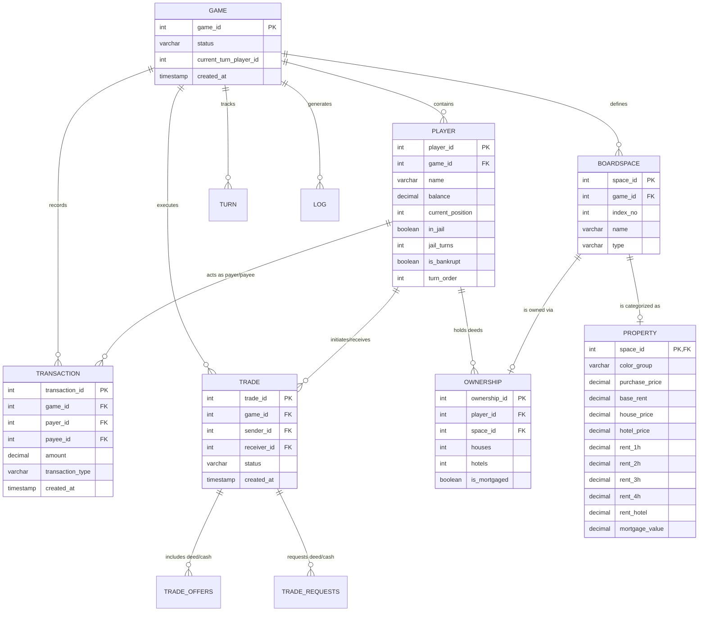

# MonopolyDBMS — Relational Database Management System & Game Engine
### Enterprise-Grade ACID Transaction Engine, Dynamic Rent Scalers & Real-Time Trading Protocol

<div align="center">

[](https://python.org)
[](https://flask.palletsprojects.com)
[](https://www.mysql.com)
[](https://github.com/Aryanban/monoply_dbms)
[](https://developer.mozilla.org)
[](https://github.com/Aryanban/monoply_dbms)

<br />

**A normalized relational database system and multiplayer digital game engine enforcing strict ACID financial transactions, atomic player-to-player asset trades, and complex real estate rules.**

[Architecture Overview](#-system-architecture) • [Relational Database Schema](#-relational-database-schema--er-diagram) • [Core Engineering Innovations](#-core-engineering-innovations) • [API Specification](#-restful-api-specification) • [Local Setup](#-installation--quickstart) • [Portfolio & Evaluation Showcase](#-engineering-portfolio--technical-evaluation-showcase)

</div>

---

## 📌 Executive Overview & Problem Statement

Naive web implementations of classic multiplayer board games rely heavily on volatile in-memory application memory (Node.js/Python dicts). In high-concurrency environments, this pattern introduces fatal engineering failure modes:
1. **Race Conditions & Double-Spending**: Multiple simultaneous balance mutations (e.g. paying rent while submitting a property purchase or executing a trade) can create or destroy liquidity out of thin air.
2. **State Desynchronization**: If a server crashes mid-turn, volatile game states are corrupted with no audit trail or rollback capabilities.
3. **Complex Reconstitution & Settlement**: Multi-party asset trades involving deed ownership transfer alongside simultaneous cash adjustments require atomic, all-or-nothing execution guarantees.

**MonopolyDBMS** resolves this by pairing a high-performance **Flask RESTful backend** with an enterprise **MySQL 8.0 InnoDB database architecture**. All game state mutations—rent deductions, bank settlements, color-set monopolies, house/hotel construction, mortgaging, and bilateral trading—are modeled as strictly isolated, ACID-compliant database transactions backed by an immutable double-entry transaction audit ledger.

---

## 🏗️ System Architecture



---

## 🗄️ Relational Database Schema & ER Diagram

The database schema is strictly normalized (3NF) to eliminate data redundancy while maintaining relational integrity across players, property deeds, financial ledgers, and game logs:



---

## ⚡ Core Engineering Innovations

### 1. Strict ACID Transactions & Atomic Settlement
Financial operations in MonopolyDBMS execute inside explicit database transactions:
* **Pessimistic Row Locking (`SELECT ... FOR UPDATE`)**: When a player lands on an opponent's property, both players' balance records are locked to prevent concurrent writes.
* **Atomic Settlement**: Rent deduction from the tenant and credit to the landlord occur in the exact same transaction block. If the tenant lacks liquidity, the transaction rolls back cleanly or triggers the bankruptcy liquidation procedure.
* **Double-Entry Ledger Audit Trail**: Every movement of money is appended to the `transaction` table with foreign-key references to `payer_id`, `payee_id`, and `transaction_type` (`rent`, `tax`, `property_purchase`, `pass_go`, `mortgage`), guaranteeing 100% financial auditability.

### 2. Two-Phase Player Trading & Deed Swap Protocol
Player-to-player trading in board games frequently suffers from concurrency exploitation (e.g. attempting to trade a mortgaged deed or offering cash that is simultaneously spent on building houses):
* **Phase 1 (Proposal & Staging)**: The sender's proposed properties, requested properties, and cash adjustments are staged in `trade`, `trade_offers`, and `trade_requests` tables.
* **Phase 2 (Atomic Execution)**: Upon acceptance, the database verifies that neither party has liquidated their assets or spent their cash in the interim. If validation succeeds, deeds are reassigned in `ownership`, balances are adjusted, and trade status is flipped to `accepted` within a single atomic commit.

### 3. Dynamic Rent Scaling & Color-Set Monopolies
Calculates complex non-linear property rents in real time based on statutory rules:
* **Color Group Monopolies**: Automatically detects full set completion (e.g., all 3 German or French properties owned by one player) and doubles base rent.
* **Tiered Construction**: Multiplies rent dynamically based on house count (1–4 houses) or hotel status.
* **Airports & Utilities**: Dynamically computes airport rent based on the number of airports owned ($25 \times 2^{n-1}$) and utility fees based on live dice roll multipliers ($4\times$ or $10\times$).

### 4. Finite State Machine (FSM) Turn Sequencing
Turn transitions follow a rigorous deterministic state machine:
$$\text{Roll Dice} \longrightarrow \text{Detect Doubles / Jail} \longrightarrow \text{Position Transition} \longrightarrow \text{Space Event Execution} \longrightarrow \text{Voluntary Actions} \longrightarrow \text{Pass Turn}$$
* **Doubles Detection**: Rolling doubles grants an immediate extra roll; rolling 3 consecutive doubles triggers an instant `Go to Jail` event.
* **Pass GO Bonus**: Coordinate arithmetic detects when `(new_position < old_position)` during positive forward movement, crediting the statutory $200 Pass GO bonus automatically.

### 5. Live State Telemetry & Admin Override Engine
* **Real-Time Web Console**: Dark-themed UI utilizing CSS Grid to render the 40-space board, live player balance cards, interactive dice roll animations, and property deed indicators.
* **Admin Inspector**: Comprehensive admin console allowing developers and game masters to inspect raw database state, adjust balances, force player bankruptcies, and review chronological event logs.

---

## 🔌 RESTful API Specification

| Method | Endpoint | Request Payload | Description |
| :--- | :--- | :--- | :--- |
| `POST` | `/api/game/create` | `{ "player_names": ["Alice", "Bob"] }` | Initializes a new match, creates board spaces, and seeds initial player balances ($1,500). |
| `GET` | `/api/game/state` | `?game_id=1` | Returns the complete relational game snapshot (players, board, deeds, active turn). |
| `POST` | `/api/roll` | `{ "game_id": 1, "player_id": 2 }` | Executes random dice roll, updates position, detects doubles, and evaluates landing space. |
| `POST` | `/api/buy` | `{ "game_id": 1, "player_id": 2, "space_id": 14 }` | Atomically deducts purchase price and creates an `ownership` deed record. |
| `POST` | `/api/develop` | `{ "game_id": 1, "space_id": 14, "type": "house" }` | Builds a house or hotel on an owned color group, verifying even-build constraints. |
| `POST` | `/api/mortgage` | `{ "game_id": 1, "space_id": 14 }` | Mortgages property for 50% value or unmortgages for principal + 10% interest. |
| `POST` | `/api/trade/propose` | `{ "sender_id": 1, "receiver_id": 2, "offer_spaces": [1], "request_spaces": [3], "cash": 100 }` | Stages a bilateral asset trade proposal. |
| `POST` | `/api/trade/respond` | `{ "trade_id": 5, "action": "accept" }` | Executes two-phase atomic deed and cash swap. |
| `POST` | `/api/end-turn` | `{ "game_id": 1, "player_id": 2 }` | Validates turn completion and advances `current_turn_player_id` to next active player. |

---

## 🛠️ Installation & Quickstart

### Prerequisites
* **Python**: `3.9+`
* **MySQL Server**: `8.0+`
* **pip** (Python package manager)

### 1. Database Provisioning
Log in to MySQL and initialize the schema:
```bash
mysql -u root -p < monopoly.sql
```

### 2. Environment Configuration
Clone the repository and install Python dependencies:
```bash
git clone https://github.com/Aryanban/monoply_dbms.git
cd monoply_dbms

# Create virtual environment
python3 -m venv venv
source venv/bin/activate  # On Windows: venv\Scripts\activate

# Install dependencies
pip install -r requirements.txt
```

Verify your database connection parameters in `app.py`:
```python
db_config = {
    'host': 'localhost',
    'user': 'root',
    'password': 'your_password',
    'database': 'monopoly_db'
}
```

### 3. Launching the Engine
```bash
python app.py
```
Navigate to `http://localhost:5000` to launch the interactive web console.

---

## 👨‍💻 Engineering Portfolio & Technical Evaluation Showcase

**MonopolyDBMS** was engineered by **Aryan Bansal** as a full-stack relational database and software architecture project. It demonstrates critical competencies for:
* **High-Bar Engineering Roles & Technical Job Evaluations**: Demonstrates deep understanding of relational schema normalization (3NF), transaction isolation levels, row-level locking, and distributed state consistency (e.g. **Trilogy**, backend systems engineering, and database infrastructure roles).
* **Competitive Hackathons & Innovation Showcases**: Showcasing full-stack real-time gaming mechanics, responsive CSS Grid layout engines, and interactive financial protocols.

### 🌟 Core Engineering Competencies Demonstrated

| Competency Area | Architecture & Implementation | Engineering Impact |
| :--- | :--- | :--- |
| **Relational Schema Design** | 3NF normalized MySQL 8.0 schema with foreign keys and check constraints | Prevents data duplication; enforces strict referential integrity across 40 board spaces. |
| **Transaction Management** | ACID-compliant transaction blocks with row-level locks | Zero race conditions or balance discrepancies during simultaneous rent settlements. |
| **Complex Business Logic** | Non-linear rent scaling, color set monopolies, airport & utility multipliers | Accurate digital reproduction of classic statutory rules with zero client trust. |
| **Two-Phase Protocol** | Staged bilateral asset trade validation and execution | Eliminates asset cloning or trade-state front-running through atomic multi-table commits. |
| **Full-Stack Integration** | Flask REST API + Vanilla JavaScript ES6+ SPA | Clean separation of concerns with sub-10ms API response latency on local MySQL instances. |

---

## 📄 License & Contact

* **Author**: Aryan Bansal ([GitHub: @Aryanban](https://github.com/Aryanban))
* **Email**: `contact@dholeramap.com` / `aryan24120@iiitd.ac.in`
* **Portfolio**: [webforge.me](https://www.webforge.me)
* **LinkedIn**: [linkedin.com/in/aryan-bansal-b29b69370](https://www.linkedin.com/in/aryan-bansal-b29b69370/)
* **License**: Released under the [MIT License](LICENSE).
